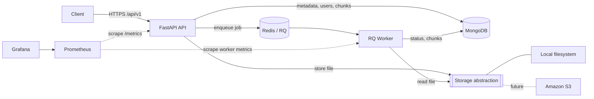

# DocuSearch — Architecture

> Status: **planned architecture** (Milestone 0). Nothing described here is implemented yet.
> Update this document as each milestone lands; the roadmap tracks what is actually built.

## 1. Goals

DocuSearch ingests documents (PDF, DOCX, TXT), processes them asynchronously, and makes their
text searchable through a REST API, scoped per user. It is a portfolio project meant to show
practical backend engineering: MongoDB design, async processing, security, observability,
containers, CI/CD and infrastructure-as-code.

Non-goals: a frontend, microservices, Kubernetes, and any AWS provisioning during development.

## 2. Style: modular monolith + one worker

One Python codebase, built into one Docker image, run with two entrypoints:

- **API** — FastAPI (async).
- **Worker** — RQ worker consuming jobs from Redis.

Both share domain code (models, repositories, storage, extraction, chunking). There are no other
services of our own. Supporting infrastructure: MongoDB, Redis, Prometheus, Grafana.



## 3. Responsibilities

| Component | Responsibility |
|---|---|
| FastAPI | AuthN/AuthZ, upload and lifecycle of documents, search, validation/serialization, health and metrics |
| MongoDB | users, document metadata and status, text chunks, refresh-token sessions |
| Redis + RQ | job queue, retries, decoupling processing from HTTP requests |
| Worker | extraction, normalization, chunking, indexing (embeddings later) |
| Storage layer | stores uploaded bytes under server-generated keys; local first, S3 later |
| Prometheus / Grafana | metrics collection, provisioned dashboards and alert rules |

## 4. Planned package layout (indicative)

Not final; it will be fixed in Milestone 1 and recorded in an ADR if it deviates.

```
src/docusearch/
  api/          # routers, dependencies, error handlers, schemas
  core/         # settings, logging, security primitives, time utils
  db/           # Mongo client lifecycle, index definitions, repositories
  storage/      # Storage protocol + local adapter (+ S3 adapter later)
  ingestion/    # extractors, normalization, chunking, processing state machine
  search/       # search service
  worker/       # RQ entrypoint and job functions
  llm/          # optional provider abstraction (disabled by default)
tests/          # unit/, integration/, e2e/
docs/
infra/          # terraform/, scripts/ (prepared only, never applied)
```

Dependency direction: `api` and `worker` depend on domain/service code; services depend on
`db`, `storage`; nothing depends on `api` or `worker`.

## 4b. Data model and indexes

Four collections. Field lists are indicative until their milestones; the **indexes below are
implemented** (`src/docusearch/db/indexes.py`, rationale in ADR-0013).

| Collection | Holds | Indexes |
|---|---|---|
| `users` | account, normalized email, password hash | `email` unique |
| `documents` | metadata, owner, status, `sha256`, timestamps | `(owner_id, created_at desc, _id desc)`; `(owner_id, sha256)` unique; `(status, updated_at)` |
| `chunks` | extracted text pieces of one document | `(document_id, chunk_index)` unique |
| `refresh_tokens` | hashed refresh tokens (sessions) | `token_hash` unique; `expires_at` TTL; `user_id`; `family_id` |

Data access goes through one small repository class per collection (`src/docusearch/db/repositories/`,
ADR-0014); ownership is part of every document/chunk query. The text index used by search is added in
Milestone 6. Indexes are created idempotently at startup; if
MongoDB is unavailable then, the process still starts and the `indexes` readiness check retries.

## 5. Document lifecycle

States: `pending → processing → completed | failed`.

1. `POST /api/v1/documents` validates the upload (size, allowed type via content sniffing, not
   only extension/MIME), computes SHA-256, stores bytes under a server-generated key, inserts
   the metadata as `pending`, enqueues a job, and returns **202 Accepted**.
2. The worker atomically claims the document (`pending → processing`, conditional update), so
   two workers cannot process the same document concurrently.
3. It extracts text, normalizes, chunks, and writes chunks, then marks the document `completed`.
4. Failures are classified as transient (retry with bounded attempts) or permanent (`failed`
   with a safe, generic error message exposed to the client).

Reliability principles (MongoDB, Redis and the filesystem are **not** one transaction):

- **Idempotency:** chunks are keyed deterministically (document id + chunk index) or replaced
  as a unit, so repeated jobs never create duplicates.
- **No partial visibility:** search only considers chunks of documents in `completed` state.
- **Recovery:** a reconciliation task re-enqueues or fails documents stuck in `pending` or
  `processing` beyond a timeout (e.g. enqueue failed after insert, or a worker died).
- **Upload ordering:** store file → insert metadata → enqueue. Orphaned files and
  unenqueued documents are handled by reconciliation, not assumed impossible.

## 6. Security model (summary)

- Short-lived JWT access tokens (algorithm pinned, signature/exp/sub validated); refresh tokens
  rotated and stored only as hashes; logout revokes.
- Passwords hashed with Argon2id; emails normalized consistently; registration/login avoid user
  enumeration where practical.
- Ownership is enforced **in the database query** (`{_id, owner_id}`), never from client-supplied
  user ids.
- Uploads are untrusted: server-generated storage keys, no client filenames in paths, size
  limits, allowlisted types, no filesystem paths in responses.
- Secrets come from environment variables / a secret manager; never logged, baked into images or
  committed.
- `/metrics` is restricted to the monitoring network.

## 7. Search

Initial search uses MongoDB text indexes over chunks, always filtered by authenticated owner and
completed documents. Results carry document and chunk identifiers and, when reliably known, page
numbers. Ranking scores are relative, not probabilities. Hybrid search and embeddings are later,
optional work and sit behind a search-backend boundary.

## 8. Observability

- Structured JSON logs with request and job correlation IDs; no secrets or document content.
- Prometheus metrics with bounded label cardinality (no user/document/request ids).
- Worker metrics are exposed on a separate scrape target.
- Grafana dashboards and datasources provisioned from files: API Health, Document Ingestion
  Pipeline, Infrastructure and Dependencies.

## 9. Deployment

- **Local:** Docker Compose (API, worker, MongoDB, Redis, Prometheus, Grafana) with pinned image
  versions and persistent named volumes.
- **AWS (prepared only):** ECS Fargate (API + worker), ECR, S3, MongoDB Atlas, managed Redis,
  Secrets Manager, CloudWatch, ALB, IAM and VPC, defined in Terraform modules. Resources are never
  provisioned during development; see `docs/decisions.md` (ADR-0006).

## 10. Open questions

- Final choice of PDF/DOCX extraction libraries (Milestone 5) — must preserve page numbers for
  PDFs where reliably available.
- Managed Redis flavor for AWS compatible with RQ (Milestone 11).
- Rate-limiting backend (Redis-based vs in-process) (Milestone 7).
